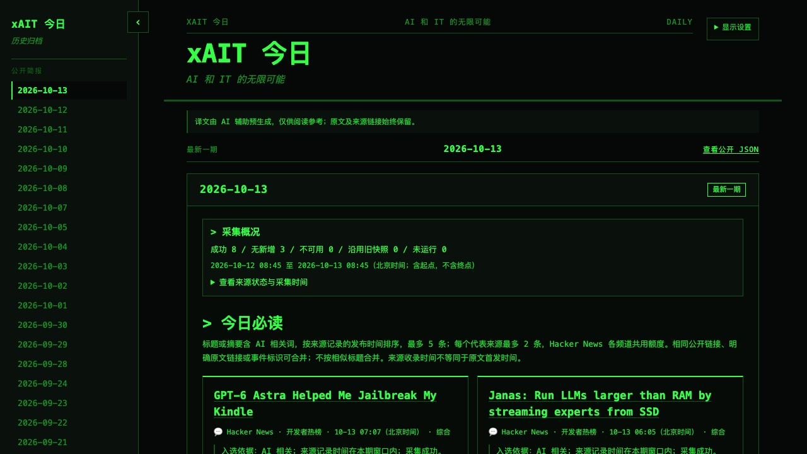
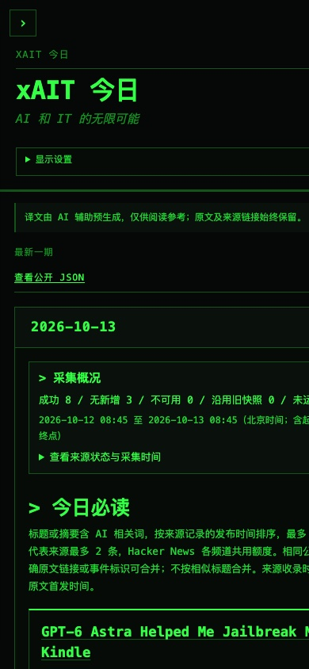
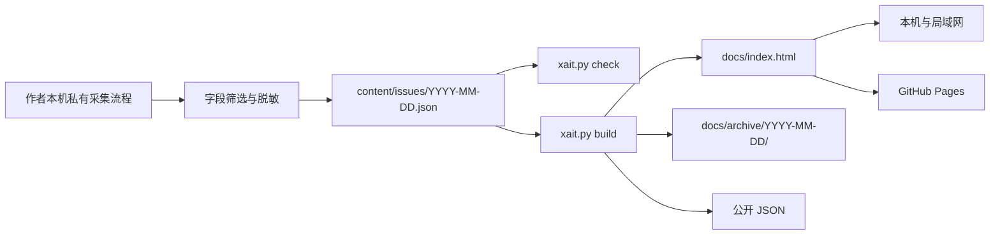

<div align="center">

# xAIT 今日

### 今日必读｜原文可追溯｜可离线部署

把重点公众号、开源项目、开发者讨论、论文与产品发现中的公开信号，整理成一份带来源状态、可继续核验的每日 AI 简报。

[在线体验](https://nicoleyang959.github.io/xait-today/) · [本机部署](#本机部署) · [数据边界](#数据与隐私边界)

</div>



<details>
<summary>查看移动端效果</summary>



</details>

## 项目介绍

`xAIT 今日` 是一个本地优先、可公开部署的 AI 资讯仪表盘。

它将不同来源的信息整理到同一个页面中，帮助读者按照下面的顺序完成每日阅读：

1. 查看采集概况，确认本期时间窗口与来源是否有效。
2. 阅读「今日必读」：从合格候选中最多选出 5 条事件，不为凑数补足。
3. 查看入选理由、来源及时间；同一事件的相关链接可展开核验。
4. 按「中文信号、资讯与讨论、产品与开源、研究前沿」继续阅读；通过质量门槛的可选观察源会单列为「一线信号」。
5. 沿原始链接深入阅读，或通过历史侧栏查看真实日期的往期快照。

以上阅读层适用于 v2 issue；已有 v1 历史 issue 保持原有内容与按来源阅读方式。

项目采用原生 HTML、CSS、JavaScript 和 Python 标准库，不需要前端框架、数据库、npm、Docker 或第三方 Python 包。

## 主要功能

- 带来源与入选理由的「今日必读」，最多 5 条
- 统一的北京时间日窗口与可展开的来源状态
- APPSO、数字生命卡兹克、智东西、花叔每日公开推文
- GitHub Trending 与本周新晋高星项目
- Hacker News AI 热门讨论、arXiv 论文与 AI 相关科技媒体信号
- Product Hunt 官方精选日榜 Top 10，以及独立的近期新品索引
- 可选的「X · AI 观察信号 Top 10」ID-only 通栏（默认不启用，不进入今日必读）
- 真实日期历史归档
- 可收起的日期侧栏
- 中文 / English 阅读切换，支持查看新闻原文
- 桌面端和移动端响应式布局
- 七套可切换阅读主题
- 完全离线的页面构建与本机运行
- 面向编程智能体的统一检查、构建和部署接口

### 本次更新：编辑阅读层与 v2 兼容

- 同时支持 v1 与 v2 issue。v1 历史数据无需迁移，v2 在原来源章节前增加采集概况和「今日必读」。
- 每一期的精选窗口为北京时间前一天 08:45 至当日 08:45，共 24 小时，采用左闭右开区间 `[start, end)`。发布时间与采集时间分别记录，不用采集时间冒充发布时间。
- 精选只使用已提供的公开证据；合格事件不足 5 条时按实际数量展示，没有合格事件时说明原因。不调用 LLM 生成事实、补写新闻或补造摘要。
- 通过规范化 URL、明确的 `originalUrl` 与 `eventKey` 保守归并同一事件，并保留相关链接；不会把标题相似自动认定为同一事件。
- 采集时间、最近成功时间、条数与失败说明统一收进一个可展开面板。旧快照保留原时间和状态；失败、空数据或未运行的来源不占据正文版面。
- 七套主题、浏览器主题记忆、历史侧栏和移动端阅读保持兼容。页面使用原生 `details` 展开信息，阅读不依赖联网。

为提高每日可用性，当前发布视图只保留可稳定核验且符合阅读目的的核心来源。何夕2077、Bluesky、StockTwits、Y Combinator、Hacker News Best / New，以及 Reddit、YouTube 等旧社交榜单已停用；小红书和抖音也不再采集。历史规范输入保留原始记录，构建时生成过滤副本，普通资讯正文中提及这些平台的新闻仍正常展示。

Product Hunt 分别展示「热门产品 Top 10」与「近期新品」。热门产品来自官方精选日榜，保留官方名次、产品短简介与可核验的积分；积分是综合互动分数，不等同于点赞数。每天北京时间 08:45 的简报，选择该时刻对应太平洋时间日期的前一天，即最近一个完整日榜，并标明榜单日期、太平洋时区和采集时间；榜单日期不充当产品发布日期。条目缺少经过核验的产品链接时显示纯文本名称，仍可通过模块内的官方日榜链接核验，不猜测 URL。采集失败时隐藏日榜正文，只在来源状态中记录，不沿用旧榜；这个独立来源不会进入「今日必读」或影响核心来源发布门槛。公开 Atom 数据继续作为「近期新品」索引，不宣称是官方热门排名。Techmeme 仅在成功取得 AI 相关条目时显示，最多 5 条；AIHot 只作为候选发现信号，不直接铺成长列表。

作者端的 Product Hunt 日榜采用零新增付费服务方案：由已有浏览器工具只读获取正常可访问的官方页面，经日期、精选范围、完整十名及字段白名单校验后，交付当天的脱敏数据。无需购买 API、代理或云端采集服务，不读取或导出浏览器登录凭证；遇到访问限制、验证码、规则不允许或页面结构变化即停止，不切换抓取后端继续尝试。此流程依赖本机和已有工具可用，不能保证每天都有榜单；失败时其他简报来源继续更新。公开仓库不包含浏览器采集器，也不要求部署者安装浏览器自动化依赖，clone 后的离线构建方式保持不变。

公共构建器预留独立来源 `x-ai-signals`。只有作者的私有采集端完成同日校验并显式启用后，页面才显示「X · AI 观察信号 Top 10」；它仅包含项目分类标签、规范化 Post ID 链接和本期排名，不复制帖子原文、作者、媒体或互动数，也不会进入「今日必读」。空结果或不可用时正文模块自动隐藏，且不影响核心资讯发布。

作者的私有采集端使用可选 Crawl4AI 进行部分公开列表提取。采集器、运行环境及登录态**不在本仓库中**；clone 用户仍只需 Python 标准库即可构建和部署已有内容。

### 中英文阅读

页面右上方提供 **中文 / English**，语言选择会在刷新和历史页面间保留，也可通过 `?lang=en` 或 `?lang=zh` 分享指定语言。语言与七套主题、侧栏状态独立。

- 界面文案、来源状态、日期口径及本期资讯标题和描述使用预先准备的双语内容；不在浏览器中调用翻译接口。
- 「查看原文 / Show originals」只切换新闻文本，不改变界面语言，也不改变来源链接、排名、发布时间或互动数值。
- 译文为 AI 辅助翻译，供阅读参考，不代表对原文事实的再次核验。历史或新增内容缺少译文时保留原文，并显示「暂无译文」；不会用旧译文匹配已变更的标题。
- `site/i18n/ui.json` 保存固定界面字典；`site/i18n/content.json` 保存公开内容译文。每条内容译文以原始文本为键，并用 `sourceSha256` 绑定该文本的 UTF-8 SHA-256。
- 原始 `content/issues/`、公开 issue 和兼容 JSON 不改写为译文。构建器校验全部译文，只把本期需要的译文嵌入惰性模板；浏览器使用文本节点切换，不插入译文 HTML。

新增内容译文的结构如下（`sourceSha256` 必须填入原文真实摘要，可用 Python `hashlib.sha256(source.encode("utf-8")).hexdigest()` 生成）：

```text
schemaVersion: 1
entries:
  原始文本:
    sourceSha256: 原始文本的 SHA-256
    zh: 中文译文或原始中文
    en: 英文译文或原始英文
```

修改字典后运行 `python3 xait.py build` 和 `python3 xait.py check`。译文准备与每日采集分开：此版本不新增云端翻译、收费 API、登录或后台服务；没有新译文时每日发布仍可正常进行。

此设计借鉴 [AIHOT 的中文/原文切换与预生成翻译思路](https://github.com/KKKKhazix/AIHOT/blob/8e34e05feb161cb5838e592ee22715f791c7f814/packages/backend/src/editorial/translate.ts)，在本项目中独立实现，不复用其后台、正文采集或模型凭据。

## 本机部署

### 环境要求

只需要：

- Git
- Python 3.9 或更高版本
- 一个现代浏览器

不需要安装任何 Python 第三方依赖。

### macOS / Linux

```bash
git clone https://github.com/nicoleyang959/xait-today.git
cd xait-today
python3 xait.py serve
```

启动成功后访问：

```text
http://127.0.0.1:8022/
```

### Windows

```powershell
git clone https://github.com/nicoleyang959/xait-today.git
cd xait-today
py -3 xait.py serve
```

启动成功后访问：

```text
http://127.0.0.1:8022/
```

`serve` 会先检查公开数据并重新构建页面，全部通过后才启动本地服务。

按 `Ctrl+C` 可停止服务。

## 局域网访问

如果需要让同一 Wi-Fi 或局域网内的其他设备访问：

```bash
python3 xait.py serve --lan
```

指定端口：

```bash
python3 xait.py serve --lan --port 8022
```

程序会显示可访问的局域网地址。

默认模式只监听 `127.0.0.1`。只有显式使用 `--lan` 时，页面才会向局域网开放。

## 检查与重新构建

只检查数据、页面结构和安全边界：

```bash
python3 xait.py check
```

从公开 JSON 重新生成首页和全部历史归档：

```bash
python3 xait.py build
```

构建过程完全离线，不会：

- 访问外部网站
- 调用数据采集器
- 读取用户主目录
- 读取浏览器或 Cookie
- 读取环境变量中的密钥

相同输入应当生成完全一致的输出。

## 给编程智能体使用

Codex、Claude Code、Gemini CLI 或其他编程智能体 clone 仓库后，应遵循相同流程：

```bash
python3 xait.py check
python3 xait.py serve
```

智能体不需要知道项目最初在哪台电脑上生成，也不需要访问作者的私有目录。

仓库中的约定：

- `content/issues/` 是页面的规范数据来源。
- `docs/` 是生成后的静态网站。
- `outputs/` 仅保存公开研究快照，不是隐式构建输入。
- 不得猜测或调用作者的私有采集脚本。
- 不得创建虚假的当天数据或历史日期。
- 不得提交 Cookie、令牌、密码、数据库或浏览器状态。
- 使用局域网模式前应获得设备使用者授权。

更完整的智能体协作规则见 [`AGENTS.md`](AGENTS.md)。

## 项目结构

```text
xait-today/
├── xait.py                    # 检查、构建和本机运行入口
├── AGENTS.md                  # 通用智能体协作约定
├── content/
│   ├── schema/                # 公开数据结构说明
│   └── issues/
│       └── YYYY-MM-DD.json    # 每一期的规范公开数据
├── site/
│   ├── templates/             # 页面模板
│   └── assets/                # 七套主题与交互源码
├── docs/
│   ├── index.html             # 最新一期
│   ├── archive/               # 真实历史归档
│   ├── issues/                # 可公开核验的结构化数据
│   ├── assets/                # 生成后的 CSS 与 JavaScript
│   ├── history.json
│   └── health.json
├── outputs/                   # 公开研究快照
└── tests/                     # Python 标准库测试
```

## 工作原理



公开仓库只负责：

- 保存脱敏后的公开数据
- 校验数据结构
- 生成静态页面
- 提供本机和局域网访问
- 发布 GitHub Pages

登录态采集与账号相关操作不包含在公开仓库中。

## 公开数据格式

每一期使用一个自包含 JSON 文件：

```text
content/issues/YYYY-MM-DD.json
```

字段约束见 [v1 schema](content/schema/issue-v1.schema.json) 与 [v2 schema](content/schema/issue-v2.schema.json)。v2 扩展公开来源记录与可追溯条目，由离线构建生成编辑阅读层；不改变 v1 历史 issue 的格式。

兼容的 v1 基本结构如下：

```json
{
  "schemaVersion": 1,
  "date": "2026-09-03",
  "generatedAt": "2026-09-03T08:45:00+08:00",
  "title": "xAIT 今日",
  "tagline": "AI 资讯 · IT 热点 · 每日精选",
  "sections": []
}
```

v2 将 `schemaVersion` 设为 `2`，保留这些基本字段与 `sections`，另增加：

- `edition`：本期的 `windowStart` 与 `windowEnd`。
- `sources`：来源标识、显示名称、状态、检查时间、最近成功时间、条数与说明。
- `articles`：条目标识、所属来源、标题、原文 URL、发布时间证据、采集时间与分类；可选 `originalUrl`、`eventKey` 和有依据的 `summary`。

`dateEvidence` 区分带时区的准确时间（`exact`）、仅知道日期（`day`）与未知时间（`unknown`）；未知发布时间使用 `null`。来源章节可以保留时间证据不完整的条目，并明确显示状态；「今日必读」依据校验后的时间与来源条件筛选。精选及其相关链接由构建推导，不需要在 JSON 中维护第二份精选列表。

两种版本的原来源章节继续使用以下结构化类型：

- `blocks`
- `links`
- `table`
- `wechat`
- `social`

数据中不允许直接嵌入原始 HTML 或可执行代码。

`product-hunt-ranking` 是 v2 的专用 `links` 章节。它的 `items` 使用 `{ "rank": 1, "title": "产品名", "description": "来源短简介", "url": "https://www.producthunt.com/products/example", "points": 123 }`；`url` 和 `points` 仅在可核验时提供，其他字段必需。`ranking` 保存 `date`、`timezone: "America/Los_Angeles"`、对应日期的官方 `url`、带时区的 `capturedAt` 和 `scope: "featured"`。可选的 `captureMethod: "manual-review"` 会在页面明确显示人工核验；默认 `public-page` 表示公开页面采集。名次必须从 1 连续升序，最多 10 条；来源条数与正文一致，禁止将榜单生成 `articles`，或把日榜日期转成产品发布时间。没有有效条目时只提供来源状态，不提供空的章节。`product-hunt` 原有近期新品格式保持兼容。

## 七套阅读主题

| 主题 | 特点 |
|---|---|
| 终端 | 黑底、荧光绿、等宽字体、高信息密度 |
| 赛博 | 深色、霓虹青、科技感与轻发光 |
| 瑞士 | 冷白、钴蓝、模块网格和清晰编号 |
| 杂志 | 奶油纸、酒红、衬线字体、编辑式版面 |
| 咨询 | 海军蓝、雾灰、证据卡片和正式层级 |
| 极简 | 白色、石墨、单栏与专注阅读 |
| 纸张 | 亚麻色、棕墨、柔和阴影和慢阅读体验 |

主题选择和侧栏状态只保存在当前浏览器中，沿用现有偏好存储键。收起侧栏后，其历史链接不占用键盘焦点；页面顶部提供跳到正文的入口。

页面使用跨平台系统字体，不依赖 Google Fonts；断网时仍可正常显示主题、内容和归档。

## 数据与隐私边界

公开仓库不会包含：

- Cookie 或浏览器存储
- 登录令牌、密码或 API 密钥
- 私有平台或公众号后台数据
- 本机数据库和缓存
- 原始登录态响应
- 本机绝对路径或局域网 IP
- 不可公开核验的公众号阅读量

公众号部分只展示公开文章列表中的：

- 账号名称
- 文章标题
- 发布时间
- 文章或账号列表链接
- 来源状态

公开页面不发布社交平台原文或互动数据榜单。可选 X 观察模块只公开 Post ID 链接、项目分类标签和本期排名；开源项目、开发者讨论和新品索引中的数字只代表来源在对应采集时间公开展示的状态，不跨来源比较热度。

离线构建和浏览不会连接 AIHot、调用模型或请求外部数据 API。可选观察信号只会由作者的私有采集端转换成经过校验的公开元数据，采集器和凭据不会进入仓库。

## 数据刷新说明

clone 仓库后，可以直接部署和重建仓库已经包含的公开内容。新的每日数据仍由作者本机的私有流程从限定的公开列表与公开 API 采集，经脱敏和 schema 校验后输出为公开 issue JSON；仓库本身不包含联网采集器。

当前每日流程不采集小红书、抖音。X 是独立、可选且非阻断的观察来源，默认保持私有影子模式；只有在用户明确授权后，本机私有进程才允许读取 Chrome 中的 X 登录态，相关 Cookie 不进入仓库。任何来源出现验证、超时或结构变化时，会停止该来源、不尝试绕过验证，也不把旧内容冒充当天数据；失败状态只在可展开的来源面板中记录，不生成占位大卡片。

## GitHub Pages

公开版本：

<https://nicoleyang959.github.io/xait-today/>

GitHub Pages 使用 `main` 分支中的 `/docs` 目录。

本机构建结果和 GitHub Pages 使用相同的静态文件，因此二者应保持一致。

## 项目状态

项目仍在持续迭代，近期重点包括：

- 保持 v1 历史数据与 v2 编辑阅读层兼容
- 提升公开证据、来源状态与陈旧信息的可读性
- 优化移动端阅读效率
- 维护离线、确定性构建与安全边界检查
- 保持本机版本与 GitHub Pages 一致

## License

本项目使用 [MIT License](LICENSE)。

页面中的文章标题、摘要、品牌名称及外部内容归原作者或对应平台所有。仓库只提供信息整理、链接索引和公开快照。
